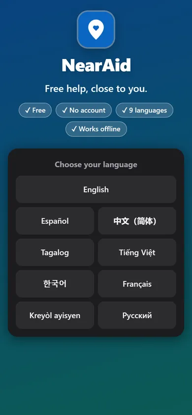
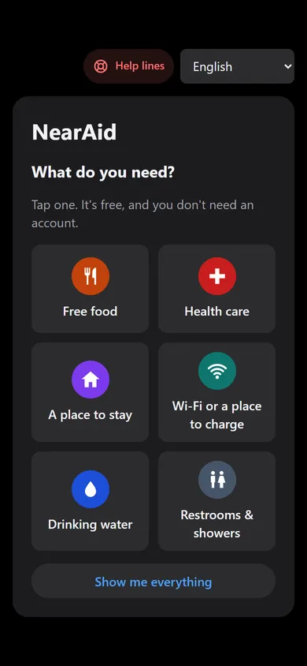
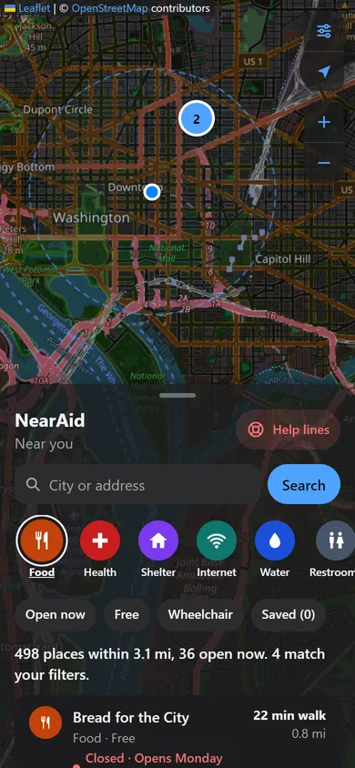
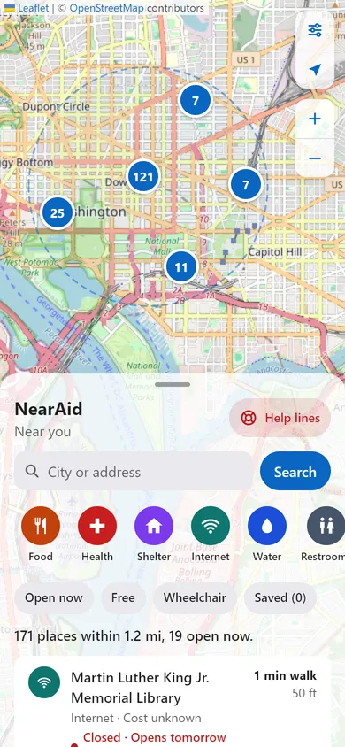
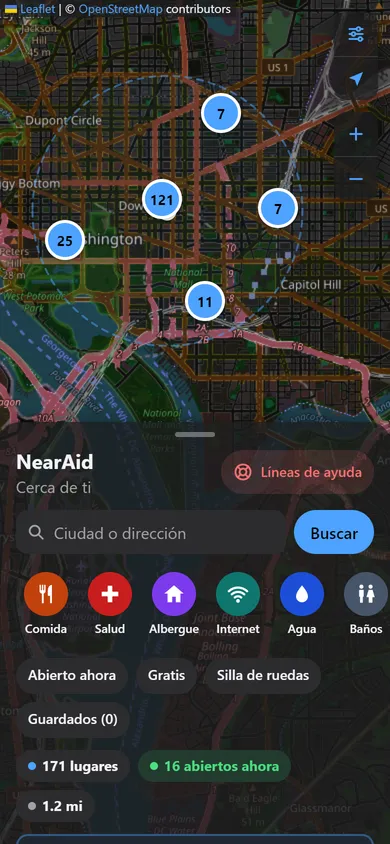
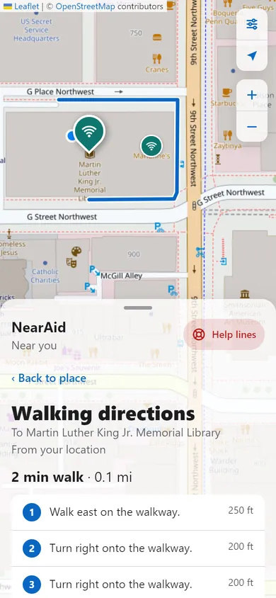
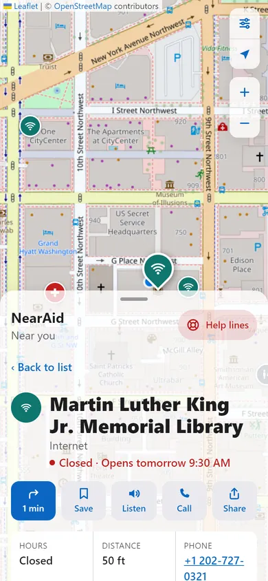
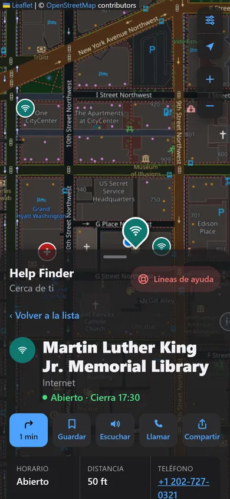
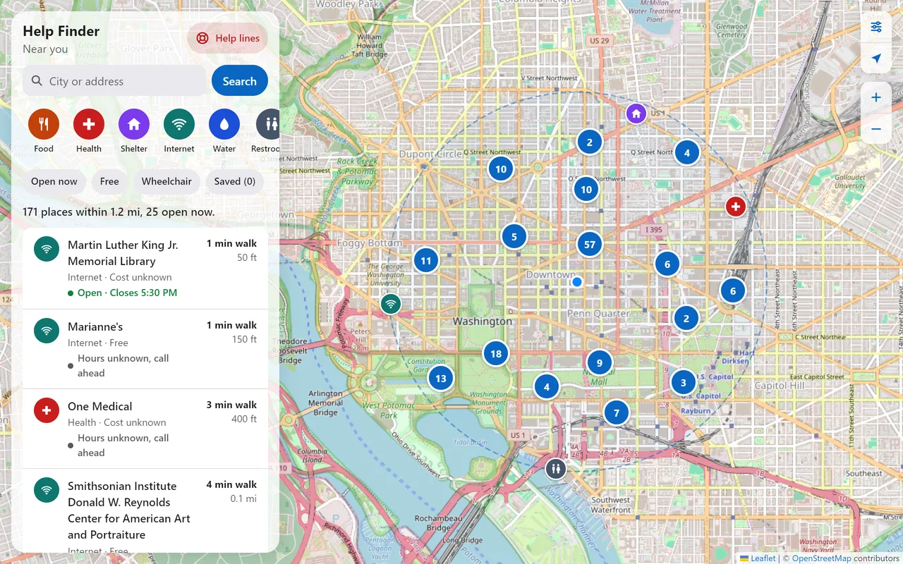

# NearAid

**Free help near you, in nine languages, anywhere, even in airplane mode.**

NearAid is a free map app that shows free food, health care, shelter, internet, drinking water, restrooms, and showers near you. It tells you what's **open right now** and shows you **how to walk there**. It works on any phone with a web browser, installs to the home screen, and can work with no signal at all.

**Try it:** https://nandan458.github.io/help-finder/

|                                Pick a language                                |                                                  What do you need?                                                  |                           Free food, nearest first                           |
| :---------------------------------------------------------------------------: | :-----------------------------------------------------------------------------------------------------------------: | :--------------------------------------------------------------------------: |
|  |  |  |

|                             Light, English                              |                                   Dark, Spanish                                   |                                 Walking directions                                 |
| :---------------------------------------------------------------------: | :-------------------------------------------------------------------------------: | :--------------------------------------------------------------------------------: |
|  |  |  |

|                                  Place card, English                                   |                              Place card, dark, Spanish                               |
| :------------------------------------------------------------------------------------: | :----------------------------------------------------------------------------------: |
|  |  |



---

## The problem

People who need help often don't know what's nearby or when it's open. The information is scattered and out of date, most directories cover just one city or need an account, and showing up somewhere closed wastes a trip that may have cost bus fare or a missed shift.

## Who it helps

- **Anyone who needs free resources, wherever they are:** people new to an area, people experiencing homelessness, travelers, families on a tight budget, and people who speak languages other than English. Many of them use older phones with limited data, so the app is small, fast, and works offline.
- **People who help others:** counselors, librarians, social workers, and volunteers can look up nearby resources and share a link to one place.

## Features

- **Starts with what you need.** The first screen asks "What do you need?" with big picture buttons: free food, health care, a place to stay, Wi-Fi or a place to charge, drinking water, restrooms and showers. One tap, and the map opens filtered to that.
- **Nine languages, chosen on first launch:** English, Español, 中文 (简体), Tagalog, Tiếng Việt, 한국어, Français, Kreyòl ayisyen, and Русский. Adding a language means adding one file. Walking steps are in your language for Spanish, French, Vietnamese, Korean, and Russian; the routing service doesn't offer the other three, so those show English steps with a note.
- **Works in airplane mode.** Save your state once (Settings → Offline use, about 1 to 4 MB) and every search there works with no signal, even in places you never visited. Without that, the app still opens offline and shows your last results and saved places.
- **Fast.** Searches inside the U.S. read small pre-made files, instead of waiting 30 to 60 seconds for a busy public map server.
- **Open now.** Every place with hours shows _Open · Closes 7:00 PM_, _Closes soon_, _Closed · Opens tomorrow 9:00 AM_, or _Hours unknown, call ahead_, updated every minute.
- **Looks farther when it needs to.** If you pick _Free food_ and the nearest food bank is 3 miles away, it looks that far and tells you. If there's none, it says how far it looked and shows the help lines.
- **Map and list together.** Color-coded pins that group into numbered bubbles, and a list sorted by walking time.
- **Filters:** category buttons, plus _Open now_, _Free_, _Wheelchair_, and _Saved_.
- **Place card:** status, distance and walk time, address, tap-to-call phone, website, the week's hours with today highlighted, cost, and wheelchair access.
- **Directions for walking, biking, and driving, in the app.** Pick how you're traveling and the route is drawn on the map, with the time, distance, and numbered steps. For **bus or train**, the app opens your phone's maps app instead, because live schedules aren't in free map data and NearAid won't guess them. The maps app is also one tap away for turn-by-turn navigation.
- **A shareable help list for people who help others.** One tap makes a clean list of the nearest places for the need you picked, with addresses, hours, and phone numbers, in your language. Print it, text it, or copy it, so a counselor or librarian can hand it to someone without a smartphone.
- **Improve the map.** Every place links to OpenStreetMap's editor to fix or update it, and Settings explains how to add a missing place, so volunteers' fixes reach the app with the weekly update.
- **Read aloud** in the current language, **saved places**, and **share a place** (every place has its own link).
- **Help lines, always one tap away:** 911, the 988 Suicide & Crisis Lifeline, and 211.
- **Installable** to the home screen like a regular app.
- **Settings:** light, dark, or automatic appearance; larger text; a plain-language privacy page; offline use; and _Clear data on this device_.
- **Accessible:** works with a keyboard and screen readers, color is never the only clue, buttons are large enough to tap, and an automated accessibility check (axe) finds no problems.

## How it works

1. **Where are you?** The app asks for the phone's location. If you say no, you can type a city or address; [Nominatim](https://nominatim.org/), OpenStreetMap's search service, turns it into a point on the map.
2. **What's nearby?** Once a week, a GitHub job downloads every U.S. state from [Geofabrik](https://download.geofabrik.de/) (daily OpenStreetMap extracts built for bulk use) and keeps the free places: 204,000 in all. It cuts them into 9,400 small files, one per square about 28 km tall, and publishes them next to the app. To search, your phone downloads the one to four squares around you. Outside the U.S., or if anything is missing, it falls back to asking the live [Overpass API](https://overpass-api.de/).
3. **Cleaning up the data.** [OpenStreetMap](https://www.openstreetmap.org/) is made by volunteers, so the same kind of place is tagged in different ways. [`categories.ts`](src/lib/categories.ts) decides which tags count as which category, removes duplicates (a library mapped both as a point and as its building), and only calls a place _Free_ when the data says so. The weekly job uses the very same function, so the offline files can never disagree with the app.
4. **Open now.** The [opening_hours](https://github.com/opening-hours/opening_hours.js) library reads OSM's compact hours format (`Mo-Fr 09:00-17:00; Sa 10:00-14:00`, holidays, sunrise-sunset...). [`hours.ts`](src/lib/hours.ts) turns that into "open, closed, or unknown, and when that changes".
5. **Walking directions.** [Valhalla](https://github.com/valhalla/valhalla), a free routing service run by the [FOSSGIS](https://fossgis.de/) volunteers, returns the route and the steps.
6. **Saving for later.** Squares and search results are saved on the phone (IndexedDB), and a service worker keeps a copy of the app itself.

## Tech stack

| Part    | What we use                                                                                                                                                                                                                                                               |
| ------- | ------------------------------------------------------------------------------------------------------------------------------------------------------------------------------------------------------------------------------------------------------------------------- |
| App     | [React 19](https://react.dev/), [TypeScript](https://www.typescriptlang.org/), [Vite](https://vite.dev/)                                                                                                                                                                  |
| Map     | [Leaflet](https://leafletjs.com/) with [react-leaflet](https://react-leaflet.js.org/) and Leaflet.markercluster (via react-leaflet-cluster), [OpenStreetMap tiles](https://www.openstreetmap.org/)                                                                        |
| Data    | [Geofabrik](https://download.geofabrik.de/) extracts filtered with [osmium](https://osmcode.org/osmium-tool/) (weekly); [Overpass API](https://overpass-api.de/), [Nominatim](https://nominatim.org/), and [Valhalla](https://valhalla1.openstreetmap.de/) routing (live) |
| Hours   | [opening_hours.js](https://github.com/opening-hours/opening_hours.js)                                                                                                                                                                                                     |
| Offline | [vite-plugin-pwa](https://vite-pwa-org.netlify.app/) (Workbox service worker), [idb-keyval](https://github.com/jakearchibald/idb-keyval) (IndexedDB)                                                                                                                      |
| Styling | Plain CSS with design tokens (CSS variables) for light and dark mode                                                                                                                                                                                                      |
| Testing | [Vitest](https://vitest.dev/): 173 tests, using saved real Overpass and Valhalla answers; the weekly data was checked against real Overpass data (172 of 172 places matched downtown DC)                                                                                  |
| Quality | ESLint, Prettier; Lighthouse mobile on the live site: Performance 97, Accessibility 100, Best Practices 100                                                                                                                                                               |
| Hosting | GitHub Pages, deployed by GitHub Actions on every push to `main`                                                                                                                                                                                                          |

No backend, no accounts, no API keys, no tracking, no ads. Everything runs in the browser.

## Run it yourself

You need [Node.js](https://nodejs.org/) 22 or newer.

```bash
npm install
npm run dev        # start the app at http://localhost:5173
npm test           # run the tests
npm run lint       # check the code
npm run build      # make the production version in dist/
npm run preview    # try the production version (with offline support)
```

Other commands: `npm run format` (tidy the code with Prettier) and `npm run icons` (make the app icons from [`public/logo.svg`](public/logo.svg)).

To rename the app, change `APP_NAME` in [`src/config.ts`](src/config.ts). The search radii live there too. To add a language, copy [`src/i18n/en.json`](src/i18n/en.json) to a new file named with the language code and translate the values.

### Project layout

```
src/
  app/         the screens and their logic (App, FinderScreen, hooks like useNearbySearch)
  components/  pieces of the screen (MapView, Sheet, PlaceCard, RouteView, LanguageScreen...)
  i18n/        one JSON file per language, and the translation helper
  lib/         plain logic with no React: overpass, packs, categories, hours, cache, route...
  styles/      tokens.css (all colors and sizes), base.css
  test/        tests and saved real server answers (fixtures/)
scripts/build-packs.mjs        builds the offline packs from Geofabrik state files
.github/workflows/deploy.yml   checks, builds, and publishes the site
.github/workflows/packs.yml    rebuilds the offline packs every Sunday
```

### Deploying

Every push to `main` runs [the deploy workflow](.github/workflows/deploy.yml): install, lint, test, build, publish to GitHub Pages. If the lint or tests fail, nothing is published. Every Sunday, [the packs workflow](.github/workflows/packs.yml) rebuilds the offline data (about 40 minutes), saves it on a `packs` branch, and triggers a deploy. On a new copy of the repo, turn Pages on under **Settings → Pages → Source: GitHub Actions**, then run the packs workflow once by hand.

## Privacy

- **Your location** is used only to find places near you. Before it leaves the phone, it's rounded to about 100 meters. Your exact location is never saved.
- **Who receives what:** searches in the U.S. only download pre-made files from this site, so your location doesn't leave the phone for them. Outside the U.S., the rounded location goes to OpenStreetMap's Overpass server. OpenStreetMap's servers also send the map pictures. A typed place goes to Nominatim. Walking directions send the rounded starting point and the place to the routing server.
- **On the phone:** saved places, recent search results, any states you saved for offline use, and roughly where you last searched (about 1 km) are kept so the app works offline. Search results are deleted after 7 days, and everything goes right away with _Settings → Clear data on this device_.
- **No accounts, cookies, analytics, ads, or trackers.**

## Using the free map services fairly

These services are run by volunteers, so the app follows their usage rules:

- **Geofabrik:** one download of each state per week, from a GitHub server, not from phones.
- **Overpass:** only used outside the pre-made area; one search at a time, a timeout, a backup server tried once, and results saved on the phone.
- **Nominatim:** at most one request per second, and only when the person presses Search (never while typing).
- **Valhalla:** at most one request per second, and only when someone asks for directions.
- **OpenStreetMap tiles:** credited on the map, and only the tiles you've looked at are saved for offline use (at most 300, for a week). Whole map areas are never bulk-downloaded.
- **Credit and corrections:** every screen credits OpenStreetMap and links to [openstreetmap.org/fixthemap](https://www.openstreetmap.org/fixthemap), so anyone can fix wrong data. See [LOCAL-DATA-GUIDE.md](LOCAL-DATA-GUIDE.md) for how to add or fix places in your own area.

## Known limits

- **Map pictures offline:** with no signal, the map picture only shows areas you've already viewed. The places and the list work everywhere in a saved state.
- **Typing a city needs internet.** With no signal, use the location button instead.
- **Offline data is up to a week old,** and OpenStreetMap is only as complete as its volunteers make it, so the app tells people to call ahead.
- **Directions need internet** (they come from a routing server), and the steps are in English for Chinese, Tagalog, and Haitian Creole.
- **Translations** were written with AI help and should be checked by native speakers.
- **Help-line numbers** are U.S. numbers (911, 988, 211).

## Credits

- **Map data © [OpenStreetMap contributors](https://www.openstreetmap.org/copyright)**, under the [Open Database License](https://opendatacommons.org/licenses/odbl/). Every place in this app was added by a volunteer.
- [Geofabrik](https://www.geofabrik.de/) for the daily state extracts, and [osmium](https://osmcode.org/osmium-tool/) for filtering them.
- [Overpass API](https://overpass-api.de/) and [Valhalla routing](https://valhalla1.openstreetmap.de/), run by [FOSSGIS e.V.](https://fossgis.de/), and the [maps.mail.ru](https://maps.mail.ru/osm/tools/overpass/) Overpass mirror.
- [Nominatim](https://nominatim.org/) and the map tiles, run by the [OpenStreetMap Foundation](https://osmfoundation.org/).
- Open-source libraries: React, Leaflet, react-leaflet, Leaflet.markercluster, react-leaflet-cluster, opening_hours.js, idb-keyval, vite-plugin-pwa and Workbox, Vite, Vitest, TypeScript, ESLint, Prettier.

## How this app was built

I planned the app: the problem, who it's for, its features, and its design. I built it with help from **Claude Code**, Anthropic's AI coding assistant, which wrote much of the code from my plan in step-by-step phases. Each phase stopped so I could run it, review it, and decide what came next. I also decided changes along the way: the name, the language list, the "What do you need?" start screen, and that the app must work in airplane mode. The code is written to be read: comments explain _why_, so I can explain every part of it.

Other tools: Chrome and Lighthouse (testing and performance checks), GitHub and GitHub Actions (code and publishing).

---

Made for the **2026 Congressional App Challenge**.
